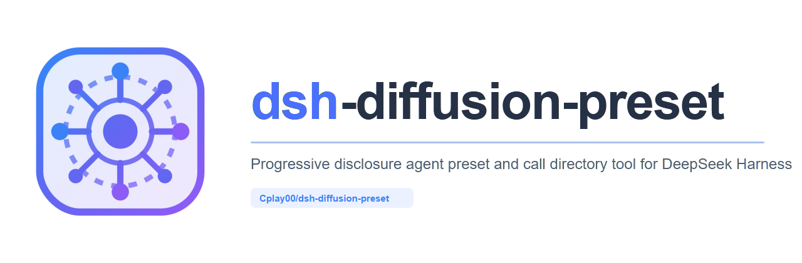

# Diffusion Mode Preset for DeepSeek Harness (扩散模式预设)

<p align="center">
  
</p>

<p align="center">
  <a href="https://github.com/Cplay00/dsh-diffusion-preset/blob/main/LICENSE"></a>
  <a href="https://github.com/topics/dsh-plugin"></a>
  <a href="https://github.com/Cplay00/dsh-diffusion-preset"></a>
</p>

[English](#english) | [中文说明](#中文说明)

---

## 中文说明

**扩散模式 (Diffusion Mode)** 是专为 [DeepSeek Harness (dsh)](https://github.com/deepseek-ai) 打造的渐进式工具与技能展开预设。

### 💡 设计哲学：从极简起步，向全能扩散

在传统 Agent 会话中，系统通常在一开始就向模型注入数十甚至上百个工具的完整 Schema 和全部系统提示词。这往往导致：
1. **初始 Prompt 极其庞大**：首轮即消耗数千至上万 Token，降低首字响应速度并增加 API 成本；
2. **上下文拥挤与注意力分散**：过多的工具定义容易引发模型在简单任务下的调用幻觉与指令稀释；
3. **极简模式与全量模式难以两全**：纯极简模式无法胜任复杂任务，而标准模式又过于臃肿。

**扩散模式通过「调用目录 → 渐进展开 → 动态收敛」解决了这一困境：**
- **初始极简**：默认开放文本读取 `read`、基础 Shell（Bash/PowerShell）、图片查看器及 `call_directory`；仅实际注册的工具可见，PTC 另保留执行传输工具。简单阅读直接开始，写入、编辑、搜索等能力按需展开；
- **自适应动态发现**：根据当前 Harness 宿主内实际安装注册的所有可调用内容（内置核心工具、MCP 外部服务、已安装社区插件与领域技能）自适应聚类，无需外部硬编码；
- **调用前建议先检索 (Search First)**：明确提醒与推荐模型在调用扩展工具前，优先使用 `call_directory({ query: "关键词" })` 检索确认当前环境中确切存在的工具或技能名称，避免盲目猜测；
- **精确挂载**：默认按工具的精确名称挂载，不自动带出兄弟工具、团队工具或整个插件。技能加载默认只提供说明；伴生依赖与领域推断均可显式配置；
- **分类浏览**：使用 `category` 检索分类候选，再用 `names` 选择当前操作需要的精确名称。分类别名和 `names: ["*"]` 仍支持显式整组展开；
- **安全门禁拦截**：强化 `tools/pre-execute` 监听门禁，若模型误调未解锁工具，自动拦截并提供智能搜索建议与一键挂载指令；
- **动态收敛**：重型任务完成后，支持通过 `unload` 卸载特定工具或 `reset` 一键重置回极简状态，保持长程会话干爽。

---

### 🚀 核心特性

- 🎯 **双预设支持**：同时提供 **扩散模式（标准版）** 与 **扩散模式（PTC 版）**，无缝适配 Native Function Call 与 Programmable Tool Calling。
- 🔍 **智能搜索与关键词检索 (Search First)**：
  - 调用未知扩展工具前，明确建议先使用 `call_directory({ query: "..." })` 进行检索；
  - 智能支持中英文同义词（如搜索 `"文档"` 自动联想 `doc`/`docx`/`office`/`file`，搜索 `"表格"` 联想 `excel`/`xlsx`/`sheet`，搜索 `"爬虫"` 联想 `crawl`/`tavily` 等）。
- ⚡ **检索后精准调用**：
  - `call_directory({ category: "file-search" })`：只读浏览文件和代码搜索工具。
  - `call_directory({ names: ["read", "grep"] })`：只挂载读取与搜索工具。
  - `call_directory({ names: ["subagent"] })`：已注册同名工具时只挂载它，不带出团队工具。
  - `call_directory({ category: "subagent" })`：只读浏览委派分类，再选择需要的工具；团队与工作流另行选择。
  - `call_directory({ names: ["*"] })`：任务确需全部能力时完整展开。
- 🔄 **动态卸载收敛**：
  - `call_directory({ action: "unload", names: [...] })`：阶段性任务结束后精准卸载，收缩上下文。
  - `call_directory({ action: "reset" })`：重置会话回极简原点。
- 📡 **按当前会话动态发现**：每次目录调用都读取当前作用域内实际注册的工具与技能，避免复用其他会话的目录。宿主可显式开启文档导出，仓库内的 `CATALOG.md` 保留为静态架构说明。

---

### 📦 安装方式

在 DeepSeek Harness 终端中执行：

```bash
dsh plugin add Cplay00/dsh-diffusion-preset
```

安装完成后，在新建会话的预设下拉列表中选择 **「扩散模式」** 或 **「扩散模式 (PTC)」** 即可启用。

---

<a id="call-directory"></a>

### 🛠️ 工具速查：`call_directory`

> 💡 **核心心智**：把 `call_directory` 当成你的**“按需能力管家 / 智能应用商店”**。
> 平时只保留最轻量的基础工具（避免上下文臃肿与模型幻觉）；遇到具体任务时，随时“搜一搜、装上它”，用完随时卸载。

---

#### 🌟 30 秒直观上手：最自然的调用三步法

无论人类查阅还是指导模型工作，整个生命周期的核心流程都极其自然：

**已有工具直接用，未知能力再发现。** 默认 `read` 可直接读取文本，无需先检索或挂载。下面以 `read` 演示完整协议，适用于自定义初始工具集未包含它，或需要查看完整参数说明的情况；默认配置下可直接跳到第三步。`call_directory` 是扩展能力的优先发现入口，不是每次操作的必经步骤。

```
① 搜工具 (lookup)        ② 装工具 (detail)        ③ 去干活 (直接调用)
   "我需要读文件"      ➜     "把 read 挂载上"    ➜     "调用 read 读取具体路径"
```

1. **第一步：搜一搜 (`lookup`)** —— 纯只读探索，不改动任何环境状态：
   ```json
   {"action": "lookup", "query": "read file"}
   ```
2. **第二步：装上它 (`detail`)** —— 从返回的候选中挑出需要的工具，按名字精准挂载：
   ```json
   {"action": "detail", "names": ["read"]}
   ```
   挂载成功后，系统会贴心返回该工具的**完整参数 Schema**，告诉你下一步该怎么调用。
3. **第三步：去干活** —— 像调用普通工具一样，直接发起目标工具调用（把具体文件路径等业务参数传给目标工具，而不是传给 `call_directory`）。
4. **按需收拢 (`unload` / `reset`)** —— 阶段结束后再评估是否卸载；小型、可复用的工具可以保留，不必每次读取后都多调用一次清理。

按任务适配与总成本选择工具：专用工具适合限定范围的读取、搜索和修改；终端适合 Git、构建、测试和有价值的批处理管道。同一任务可以混用，例如用 `read` / `edit` 检查并修改文件，再用终端执行 `git diff`。这些是选择建议，不限制模型必须走某条路径；使用任何方式都须遵守用户范围、宿主权限与验证要求。

#### 按分类获取操作引导

不知道一类工具该如何使用时，先浏览对应分类，例如向 `call_directory` 传入：

```json
{"action":"lookup","category":"file-search"}
```

返回的 **Category Workflow** 会说明该类工具的操作顺序和选择原则。例如文件搜索先定位路径、再搜索内容、最后读取相关范围；浏览器操作先确认页面状态、再交互并验证；后台任务、终端会话和智能体则各用自己的状态与控制通道。

内置能力与已知扩展能力分类都有对应引导；未知服务和自定义分类会使用通用引导。说明只针对当前作用域实际存在的分类：单一分类的检索或挂载结果按需展开，跨多个分类的宽泛结果不附带整套流程。检索引导不挂载工具，也不会安装缺失服务；模型仍按具体任务选择精确工具，再遵循实际参数 Schema 调用。

---

#### 🎭 两种模式如何调用？Native vs PTC 对照

| 特性 | 标准版 (Native Function Call) | 代码版 (PTC / `run_code`) |
| :--- | :--- | :--- |
| **运作模式** | 经典的原生工具调用（对话式一问一答） | 在 JavaScript 沙盒中写代码执行批量操作 |
| **如何查/挂载** | 发起原生工具调用：`call_directory({...})` | 在 `run_code` 中执行：`await tools.call_directory({...})` |
| **挂载后如何使用** | **在下一次模型请求中**，直接发起目标工具的 Native Call（例如 `read`），无需用户再发消息 | **在下一次 `run_code` 中**，通过 `await tools.read(...)` 调用新绑定 |
| **为什么是“下一次”** | Native 模式下当前这一轮模型已在生成，新工具在下一轮才加入工具栏 | PTC 的执行环境在单次 `run_code` 开始时已初始化，动态加载的 SDK 绑定在下一次执行生效 |

##### 极简调用代码对照：

- **Native 示例**：
  - 第 1 步检索：`call_directory({"action":"lookup","query":"read file"})`
  - 第 2 步挂载：`call_directory({"action":"detail","names":["read"]})`
  - 第 3 步执行：直接调用目标工具 `read({"file_path":"src/index.js"})`

- **PTC 示例**（已确认 `read` 存在；未知能力先检索。文件路径和参数以任务及实际 Schema 为准）：
  - 第一次 `run_code`（挂载）：
    ```javascript
    // 动态挂载需要的工具
    const res = await tools.call_directory({ action: "detail", names: ["read"] });
    console.log(res.report);
    ```
  - 第二次 `run_code`（直接尽情使用）：
    ```javascript
    // 此时 tools.read 已经就绪，可配合 JS 逻辑批量处理
    const content = await tools.read({ file_path: "src/index.js" });
    console.log(JSON.stringify(content));
    ```

---

#### 🔍 逐个细致分析：5 大动作 (Actions) 深度剖析

`call_directory` 一共提供 5 个核心动作，分工明确、职责单一：

| 动作 (`action`) | 核心效果 | 典型传参示例 | 适用场景与贴心提示 |
| :--- | :--- | :--- | :--- |
| **`lookup`** | **只读检索候选** | `{"action":"lookup","query":"表格 excel"}` | **安全探路**：支持中英文同义词联想、空格多关键词匹配。纯只读，绝不会误挂载任何工具。 |
| **`detail`** | **精准挂载 / 激活技能** | `{"action":"detail","names":["read"]}` | **解锁能力**：挂载指定工具并立即返回其参数规范；挂载技能则加载专业工作流 SOP 指导。 |
| **`catalog`** | **查看分类大纲** | `{"action":"catalog"}` | **全局俯瞰**：查看当前环境有哪些功能分类（文件、设计、网页检索等）及各自包含的工具数量。 |
| **`unload`** | **动态卸载工具** | `{"action":"unload","names":["edit"]}` | **减负瘦身**：卸载临时引入的工具；初始工具保持可用，是否包含 `read` 可通过 `initialTools` 配置。 |
| **`reset`** | **一键重置初始** | `{"action":"reset"}` | **全局归零**：一键恢复到刚启动时的极简工具集，抹平所有临时变更。 |

##### 细致要点分析：
1. **`lookup`（只读检索）的细节**：
   - **多词联合匹配**：空格分隔的关键词必须在同一个候选上同时满足。例如 `query: "文档 excel"` 查找同时涉及两者的能力。读取和编辑是不同操作，不要简单拼成 `read edit file`；可分别检索，或浏览文件分类后选择所需工具。
   - **中英文同义词自动联想**：搜 `"表格"` 会自动关联 `excel`、`xlsx`、`sheet`；搜 `"爬虫"` 会自动关联 `crawl`、`tavily`。
   - **平滑分页**：默认返回前 20 条，通过 `limit` 与 `offset` 进行翻页（例如 `{"action":"lookup","query":"read","offset":20}`）。
   - **按意图排序**：精确工具名优先；关键词恰好是功能分类或别名（如 `file` / `fs`）时，该类候选优先于名称中偶然包含关键词的其他服务。其他匹配仍可分页获取。初始工具也可检索，标为 `[Unlocked]`，无需重复挂载；排序不代替模型选择。
2. **`detail`（挂载）的细节**：
   - **单工具精准挂载（首选推荐）**：如 `names: ["read"]`。系统会返回该工具的完整参数 Schema，此时模型在下一步就可以精准传参，无需猜测。
   - **加载领域技能 ([Skill])**：当检索结果标有 `[Skill]` 时，在名称前加上 `skill:` 前缀传入（如 `names: ["skill:docx"]`），系统会返回该技能的专业 SOP 流程指南。
   - **整类与通配符挂载（高级批量操作）**：若明确需要某分类的全部工具，可以传功能分类名 `names: ["web-search"]` 或通配符 `names: ["vendor_*"]`，甚至 `names: ["*"]` 全开。建议按需使用，避免一次性涌入过多工具造成上下文拥挤。
3. **`unload` 与 `reset`（收拢）的细节**：
   - 按收益收拢，无需在每次微小操作后频繁卸载；在某个完整阶段（如完成了逆向分析、网页抓取等）结束后顺手卸载，收益最高。

---

#### 📋 参数规格与智能推断规则

`call_directory` 的参数设计兼顾了规范性与极大的人性化容错（即使不写 `action` 也能心领神会）：

| 字段 | 类型 | 作用说明 | 智能默认 / 缺省行为 |
| :--- | :--- | :--- | :--- |
| **`action`** | `string` | 显式指定五种动作之一；显式动作优先。 | **省略时自动推断**：<br>• 非空 `names` ➜ `detail`（挂载）<br>• 否则非空 `query` 或 `category` ➜ `lookup`（检索）<br>• 均未提供 ➜ `catalog`（大纲） |
| **`query`** | `string` | 搜索关键词（如 `"git commit"`、`"文档"`）。 | 仅用于 `lookup` 检索，支持中英文同义词。 |
| **`names`** | `string[]` 或 `string` | 要挂载或卸载的能力名称，如 `["read"]`、`["skill:docx"]`。 | 建议使用数组。非空名称优先于 `category`；`lookup` / `catalog` 忽略此字段。业务参数传给目标工具。 |
| **`category`** | `string` | 功能分类 ID 或别名（如 `"file"`、`"design"`、`"web-search"`），也支持来源 `"mcp:tavily"` 或 `"mcp"`。 | 在 `lookup` 时作为分类过滤条件；在 `detail`/`unload` 且未提供 `names` 时作为整类操作目标。 |
| **`offset`** | `integer` | 翻页偏移量（从 0 开始，默认为 0）。 | 仅在 `lookup` 时生效。 |
| **`limit`** | `integer` | 每页返回的候选数量上限（默认 20）。 | 仅在 `lookup` 时生效，带关键词时上限 20，无关键词分类浏览时上限 100。 |

> 💡 **贴心提示**：所有字段均可省略，用不到的字段直接不写即可，无需传入空字符串或空数组。

---

#### 🗺️ 常用分类与中英文别名速查表 (Aliases Cheat Sheet)

以下是默认的分类别名，可由配置替换；对应服务是否可用，以当前目录为准。工具精确名称与别名重名时，精确名称优先。

| 常用中英文别名 (Aliases) | 规范分类 ID | 包含的核心能力与用途 |
| :--- | :--- | :--- |
| `fs` / `file` / `文件` / `代码` | `file` | 基础文件读写、路径解析、工作目录操作 |
| `文件搜索` / `代码搜索` | `file-search` | 文件名查找、代码正则检索 (Grep) |
| `task` / `todo` / `任务` / `待办` / `计划` | `task` | 任务规划、澄清与待办管理；目标、后台任务和定时任务分别属于 `goal`、`job`、`schedule` |
| `subagent` / `子智能体` | `subagent` | 独立子智能体派发与委托 (`subagent`, `subagent_fork`) |
| `team` / `teams` / `团队` | `team` | 多 Agent 团队协作与任务板 (`spawn_teammate` 等) |
| `terminal` / `终端` / `shell` | `terminal` | Shell 命令执行、交互式终端会话与长命令执行 |
| `web` / `search` / `tavily` / `crawl` / `extract` / `网页` / `搜索` / `抓取` / `爬虫` / `调研` | `web-search` | 网页搜索、搜索引擎查询、URL 获取、正文提取、站点映射、爬虫与调研；跨提供方统一检索 |
| `dev` / `git` / `worktree` | `dev` | Git 工作树操作与宿主管理；普通 Git 命令仍可使用终端 |
| `office` / `univer` / `文档` / `表格` | `office` | 办公文档、表格的读写、交互、渲染与导出 |
| `browser` / `chrome` / `浏览器` | `browser` | 会话内浏览器自动化与页面操作 |
| `image` / `canvas` / `图片` / `生图` | `image` | AI 图像生成、图像编辑与无限画布工作台 |
| `memory` / `记忆` / `持久化` | `memory` | 跨会话持久化知识库与记忆图谱 |
| `market` / `插件市场` | `market` | DSH 插件市场浏览、安装与更新管理 |
| `ssh` / `远程` / `服务器` | `ssh` | SSH 远程主机连接、终端与集群管理 |
| `taskboard` / `看板` | `task-board` | 项目任务看板与 GitHub 集成 |
| `rea` / `reverse` / `逆向` / `反编译` | `reverse-engineering` | 二进制逆向工程、静态反编译与固件分析 |
| `design` / `opendesign` / `设计` / `原型` | `design` | UI/UX、设计系统、原型与设计资产；按当前注册工具选择设计服务 |
| `goal` / `目标` | `goal` | 长期目标追踪 |
| `job` / `jobs` / `后台任务` | `job` | 后台任务状态、输出与停止 |
| `schedule` / `定时` | `schedule` | 创建与管理定时任务 |
| `workflow` / `工作流` | `workflow` | 工作流编排与迭代 |
| `skill` | `skill` | 技能加载器与运行时依赖定位 |
| `skills` / `技能` | `skills` | 当前作用域可检索的技能指引 |
| `session` / `会话` | `session` | 按实际契约检索会话、事件与谱系 |
| `ppt` / `presentation` / `幻灯片` | `presentation` | 幻灯片预览、提案与评审 |
| `sidebar` | `sidebar` | 工作区面板导航 |
| `ui` / `card` | `artifact` | 成果卡片和结构化界面展示 |
| `desktop` / `computer-use` / `桌面控制` | `computer-use` | 桌面交互与自动化 |
| `resources` | `resources` | URI 资源及模板发现与读取 |
| `ops` / `运维` | `ops` | 批量操作与运维能力发现 |
| `notify` / `通知` | `notify` | 通知发送与展示 |
| `security` / `安全` | `security` | 安全策略检查与诊断 |

分类 ID 表达用途，工具名称保持宿主原名。`design` 不绑定某一设计产品，`web-search` 合并内置网页搜索与获取、以及已知搜索/抓取服务；是否存在某种能力取决于当前实例注册的工具。`browser` 用于交互式页面操作，`file-search` 用于本地文件检索，成果卡片归入 `artifact`，避免与联网检索混淆。

**来源与旧 ID 兼容**：候选同时标注功能分类和来源，例如 `web-search; source: mcp:tavily`。旧完整 ID（如 `core:web`、`plugin:univer`、`mcp:tavily`、`mcp:open-design`）保留来源选择语义，检索、显式挂载与卸载只作用于该来源，不会扩大到合并后的整类；其中 `core:web` 兼容原有的网页工具及 `present`。新调用推荐用通用功能 ID 浏览，再挂载精确工具名：

```json
{"action":"lookup","category":"web-search","query":"crawl"}
```

需要限定提供方时，使用 `category: "mcp:tavily"`。`names: ["web-search"]` 是显式整类挂载，可能包含多个提供方；检索结果不会自动触发这一操作。尚未配置功能映射的服务保留 `mcp:<server>` / `plugin:<prefix>` 来源分组，通过 `sourceCategories` 可归入现有或自定义功能分类。

---

#### 📦 返回值结构与诊断解读 (Response & Report)

每次调用 `call_directory`，都会返回一个标准的对象结构。无论人类还是 LLM，**直接阅读 `report` 字段即可获取最直观的信息**：

```json
{
  "stage": "detail",
  "unlocked": ["read"],
  "unloaded": [],
  "loadedSkills": [],
  "report": "..."
}
```

- **`report`（最核心的自然语言摘要）**：
  - 检索时：展示匹配的工具与技能列表，清晰标注 `[Unlocked]`（已可用）或 `[Locked]`（待挂载），并给出贴心的下一步指引；
  - 挂载单工具时：展示新解锁工具的**完整参数 Schema**，告知下一步调用该工具的具体参数格式；
  - 遇到歧义或找不到时：列出相关问题，提示继续检索或使用完整分类 ID；调用成功不代表每个请求名称都已匹配。
- **`stage`**：实际生效的动作（如 `"lookup"`、`"detail"`）。
- **`unlocked` / `unloaded`**：挂载或卸载状态记录；可包含已可用项或 `"*"` 全量标记，数组长度不是新增工具数。`reset` 不会清除历史中的技能正文。
- **`loadedSkills`**：本次加载成功的技能指引列表。

### ⚙️ 通用配置与兼容边界

本项目是 **DSH 预设**，依赖 DSH 的工具、技能、作用域及会话事件协议；不宣称能直接运行于任意 Agent 框架。分类按功能命名，已知服务映射和别名用于归并同类能力，不要求安装对应服务。

Native 与 PTC 预设均显式声明工具呈现模式，不受宿主默认模式影响。目录根据当前作用域实际注册的工具与技能生成，不依赖本机用户名、安装目录、模型提供商或固定的 MCP 服务。

效率指引优先复用已验证的名称和已可用工具，定位后读取相关范围，在证据充分时结束检索。PTC 的目录、翻页、挂载、卸载与守卫提示均使用 `await tools.call_directory(...)`，在 `run_code` 内执行；新挂载的绑定在下一次 `run_code` 使用。SDK 工具适合限定范围的操作，JavaScript 适合计算、合并独立调用与处理数据；终端也可按任务适配选择。这些是模型行为建议，不是对通用代码执行器的隔离或调用次数硬限制。

运行时示例优先显式指定 `action`，兼容已有省略写法。检索提醒按任务适配度选择、复用已可用工具；`lookup` 误传 `names` 时会说明该字段被忽略。单工具挂载详情保留完整 JSON 参数 Schema（含嵌套约束），不生成猜测的业务参数；目录返回说明后，目标操作仍须独立调用。

收敛也按收益进行：保留小型、可复用的工具集，不为每次简单读取额外调用卸载；不再使用的扩展集在上下文收益值得额外调用时再清理，且不影响仍依赖这些工具的活跃工作。

#### 自适应协作策略

模型按独立工作是否存在、上下文成本、关键路径及持续协调需求选择协作方式，不按关键词、文件数量或固定 agent 数量触发。策略只使用当前作用域实际注册的能力；默认不因展示策略而挂载或启动 agent。

| 方式 | 适用条件 | 调用原则 |
| :--- | :--- | :--- |
| 单独处理 | 简短任务、强依赖的连续步骤，或委派成本大于收益 | 直接完成，不为使用 agent 而拆分。 |
| 有界子任务 | 可独立完成的调查、实现或交叉核查，能节省时间、主会话上下文或提高验证质量 | 自包含任务优先 `subagent`；确实需要已完成会话历史时选 `subagent_fork`。只挂载选中的启动工具。 |
| 持续团队 | 独立职责需要多轮协作、共享任务依赖或持续反馈 | Lead 按需使用 `spawn_teammate`，复用已有合适成员，从最小有用团队开始；等待和任务板工具另行按需挂载。 |

初始只显示简短决策提示；挂载协作工具后，再提供任务契约和收尾要求：明确范围、必要上下文、交付物与验收证据；只读和审批限制传递给子任务；写入任务采用互不重叠的归属或串行处理；父级继续推进独立的关键路径工作，并验证、整合返回结果。Fork 不包含正在执行的当前轮，当前要求仍须写进任务说明。

成员默认完成分配范围并向 Lead 汇报，不默认再组队或递归委派。只在阻塞时等待，不轮询；`inactive` 不代表已取得有效成果。结果收齐且无活跃工作依赖工具后再卸载。团队身份与规则也会在已分配成员或已挂载协调工具时保留，不依赖始终挂载启动工具。

范围与输入足够时应先派发，再推进父级的独立工作，避免先完成子任务分析再委派。独立子智能体与持久团队可能使用不同的报告和控制通道：按启动工具的契约接收完成通知，并检查控制工具的实际适用范围；Team 专用的名册或等待工具不能证明独立子任务的状态。即使宿主没有 Team 服务，带有委派深度的子任务仍会获得有界执行和禁止默认递归的提示；只注册 fork 启动器的宿主也有对应的任务说明策略。

工具 Schema 与可识别的工具操作说明同步按需展开：单工具说明跟随对应工具，后台任务、终端、会话检索和目标追踪等组合说明跟随组内已挂载工具。卸载或移除工具后重新收起说明，作用域互相隔离。图片默认配置仅在生成/编辑工具可用时注入，画布状态跟随相关图片/画布能力；单独读取图片不会展开生图配置。

常驻引导保留检索、精确挂载、原生/PTC 调用方式和边界；协作初始只给选择提示，挂载相关工具或被分配任务后再展开契约。精简不按字符强行截断，不限制最终回复字数，也不通过省略验证减少调用。权限与审批策略、已分配成员身份及未知提示段落保持其宿主规则。

用户和工作区禁止委派的要求优先。`guide: false` 可关闭包括该策略在内的运行时指引；目录尾部提醒仍由 `usageReminder` 独立控制。策略引导模型自主选择，不保证每个模型都能稳定作出最优拆分。

兼容宿主须提供 `tools.view(scope)`（返回含 `visible: Map` 的视图）、`tools.register`、`systemPrompt.section`、`skills.list/get`、`workingDirectory.ensure`、Cordis 的事件及 effect 生命周期。预设隔离还依赖 DSH 的 `dsh.scope` 与工具层 `layers.scoped/chainLayers`；PTC 另外要求宿主提供 `run_code` 运行器和 `@deepseek-ai/dsh-agent-tool-presentation`。工具呈现插件也用于 Native 预设，以覆盖宿主默认值。完整预设的内置插件必须能由该 DSH 安装解析。

目前实机验证版本为 **DSH 0.2.1-rc.3 / Windows**。兼容目标是满足上述契约的 DSH 实例，不能据单一版本保证所有历史版本、未来版本或精简发行版。Linux/macOS 的 shell 选择由补丁中的 `process.platform` 决定，尚未在这两个系统实机验证。

将运行时选项放入 `dsh-diffusion-preset/runtime-v2` 插件的 `config`；旧入口 `/runtime` 使用同一实现。Native 与 PTC 预设各自配置，`mode` 分别保留 `native` 或 `ptc`。

| 运行时选项 | 行为 |
| :--- | :--- |
| `initialTools` | 替换默认初始工具集。仅实际注册的工具会出现；`call_directory` 始终保留，PTC 还保留 `run_code` 与 `structured_output` 传输工具。 |
| `categories` | 替换精确工具分类，格式为 `{ "custom": { "title": "Custom", "summary": "...", "guidance": "操作流程，可省略", "tools": ["tool_name"] } }`。分类 ID 使用小写。 |
| `aliases` | 替换别名映射；`{}` 清除默认别名。目标为分类 ID 或工具名称。 |
| `pluginFamilies` | 替换已知插件规则，支持 `id`、`prefix`、`exact`（名称数组）、`title`、`summary`、可选 `guidance`；`[]` 清除特判。其他带下划线的工具按首段前缀分组。 |
| `sourceCategories` | 替换来源到功能分类的映射，例如 `{ "mcp:my-search": "web-search", "mcp:my-design": "design" }`；`{}` 清除默认来源映射。精确 `categories.tools` 规则和匹配到的 `pluginFamilies` 分类优先；插件规则的 `id` 为其功能分类，`source` 可选，用于保留来源选择器。未知来源继续独立显示，不猜测其能力。 |
| `mcpDescriptions` | 替换 MCP 服务说明映射。未知服务仍按 `mcp__<server>__<tool>` 命名发现。 |
| `categoryGuidance` | 按完整分类 ID 覆盖操作引导，例如 `{ "mcp:my-server": "先检查目标，再选择操作并验证结果" }`；单项设为 `false` 或空字符串可关闭该分类引导，整体 `false` 关闭所有分类引导。不会创建分类或挂载工具。 |
| `companionGroups` | 默认 `[]`。显式配置后才展开伴随工具组；重叠组会递归展开，可能扩大挂载范围。 |
| `skillCompanions` | 默认 `{}`。显式声明技能对应的依赖，如 `{ "my-skill": ["read"] }`；分类依赖会挂载整类。 |
| `inferSkillCompanions` | 默认 `false`。设为 `true` 后按技能领域关键词推断依赖，可能展开整个领域；精准调用场景建议保持关闭。 |
| `guide` | `false` 关闭系统提示中的运行时操作指引；目录中的分类流程由 `categoryGuidance` 独立控制。 |
| `usageReminder` | 自定义目录尾部提示，或用 `false` 关闭；默认提示不强制使用子智能体或技能。 |

例如运行时配置：

```yaml
mode: native
initialTools: [read, bash, pwsh, read_image]
companionGroups: []
skillCompanions:
  my-report-skill: [read, write]
guide: false
usageReminder: false
```

集合和映射选项均为**整体替换**，不是增量合并；配置只选择已注册能力，不会安装工具或技能。技能来源完全使用 DSH 注册的 provider，不再探测固定的应用安装目录。

工具前缀展开必须显式带 `*`，例如 `names: ["vendor_*"]`；普通工具名称精确匹配。完整解锁后仍能卸载单项，卸载状态会随目录调用结果写入 Native/PTC 会话日志。`reset` 重置工具可见性，不会删除已经进入对话历史的技能正文。

工具名称与分类别名重名时，准确工具名在挂载和卸载中均优先。修改挂载状态的调用不声明为可并行执行；只读目录与检索调用可并行。显式 `action` 在执行及界面展示中具有相同优先级。

#### 可选的宿主目录导出

默认不向工作区写入文件。在宿主插件 `dsh-diffusion-preset` 的 `config` 中显式开启：

```yaml
exportCatalog: true
catalogPath: Diffusion Mode Call Directory.md
```

`catalogPath` 可为绝对路径，或相对当前工作区的路径，父目录须已存在。每次刷新都会重新解析工作区。只覆盖带本插件生成标记的文件；已有普通文件保持不变并报告错误。导出反映**宿主作用域**，不会混入任意会话私有工具；会话完整目录请使用该会话的 `call_directory()`。宿主也支持上表的目录分类、初始工具及提示选项；两处配置互相独立。

#### 验证范围

- 本地测试脚本、测试报告和缓存不纳入 Git 跟踪，也不随仓库发布。
- `npm run sync`：仅打印静态架构信息，不连接正在运行的 DSH，也不表示预设已完成实机验证。
- 真实 DSH 的工具 Schema、SDK 挂载、插件加载兼容性仍应在目标 DSH 版本中验证。
- 模拟上下文、直接调用工具执行函数或重复运行 fixture，只能证明对应单元行为，不能当作真实模型驱动的 Native/PTC 会话。报告应注明代码版本、模式、作用域、证据来源和未验证部分；常驻引导长度以实际组装并发送的内容为准。
- 判断可用状态时，比较调用当时的工具声明、目录结果和挂载事件；当前可见工具可能来自后续挂载，不能据此反推初始工具集。
- 常驻引导约 1,200 字符、小任务总调用不超过 20 次、额外挂载不超过 5 个可作优化参考，不是硬门槛；最终回复不设字符限制，也不为减少调用而省略必要验证。

---

<span id="english"></span>
## English

**Diffusion Mode** is a progressive disclosure preset and runtime for [DeepSeek Harness (dsh)](https://github.com/deepseek-ai).

### 💡 Core Concept: Minimal Origin, Progressive Expansion

Traditional AI agent workflows inject full schemas for dozens of tools and voluminous system instructions upfront. This wastes token budget and disperses model attention on simple tasks.

**Diffusion Mode** starts from a lightweight baseline (text reader `read`, shell, image reader, and `call_directory`; PTC also retains its transport). Reuse available tools directly; prefer the directory when more capabilities or content sources are needed. Choose dedicated tools, CLI commands or useful pipelines by task fit and total cost. These are recommendations, not mandatory routing rules. Exact tool names rank first; exact category/alias intent then precedes incidental keyword matches. Initial tools remain searchable as `[Unlocked]` and need no mounting. The initial set is configurable and only registered tools appear.

### 🌟 Key Highlights

- **Lightweight First-Turn Context**: Reduces upfront tool schemas; actual token savings depend on the installed environment and configuration.
- **Dynamic Scoped Discovery**: Automatically inspects, categorizes, and organizes tools and skills actually installed in the current harness, without rigid external hardcoding.
- **Search First (Recommended)**: Explicitly encourages calling `call_directory({ query: "<keyword>" })` before calling extended tools to discover exact names in the environment.
- **Exact Mounting by Default**: Mount only selected names. Automatic companion groups, skill dependency maps, and domain inference are opt-in. Categories and wildcards still allow explicit whole-set expansion.
- **Efficient, Read-Only Lookup**: Multilingual search with synonym expansion returns matching candidates with concise summaries. Lookup never dumps heavy parameter schemas or skill bodies.
- **Execution Guard**: Pre-execution gate intercepts locked tool calls before dispatch, providing clear search guidance and direct mount code snippets.
- **Dynamic Unloading**: Supports `action: "unload"` and `action: "reset"` to prune tokens during long-horizon sessions.
- **Dual Preset Architectures**: Works out-of-the-box in both Native Function Calling and PTC (Programmable Tool Calling) environments.

---

### 📦 Installation

```bash
dsh plugin add Cplay00/dsh-diffusion-preset
```

Select **"Diffusion Mode"** or **"Diffusion Mode (PTC)"** when launching a session.

### Calling contract

In Native mode, call the registered `call_directory` tool with a JSON argument object. In PTC mode, call `run_code` and execute `await tools.call_directory(args)` inside its `code`; use newly mounted bindings in the **next** `run_code` call.

Use explicit actions for clarity: `{"action":"lookup","query":"read file"}` discovers candidates; `{"action":"detail","names":["read"]}` mounts the selected tool. Then invoke `read` separately using its actual schema. Mounting does not execute a business operation. Categories and wildcards in `names` deliberately select whole sets; choose exact names for precise mounting and unloading.

Focused single-category lookup/mount results include a **Category Workflow** recipe. Functional categories merge known core/plugin/MCP capabilities with provider identity retained as source metadata. Categories such as `design` and `web-search` use neutral IDs. Full legacy source IDs retain provider-only selection for lookup, mount and unload. Known capabilities have specific recipes; unknown or custom categories fall back to their registered contracts. Broad mixed results keep these recipes collapsed. Customize them with `guidance` metadata or `categoryGuidance` overrides, or disable all recipes with `categoryGuidance: false`; none of these options mounts tools or installs services.

If `action` is omitted, non-empty `names` selects `detail`, otherwise non-empty `query` or `category` selects `lookup`, otherwise `catalog`. An explicit action takes precedence. Read `report` for unmatched names, ambiguity and skill failures; a successful directory call does not guarantee every requested name matched. See the [full reference](#call-directory) for parameters and examples.

---

### 📄 License

[MIT](LICENSE) © [Cplay00](https://github.com/Cplay00)
